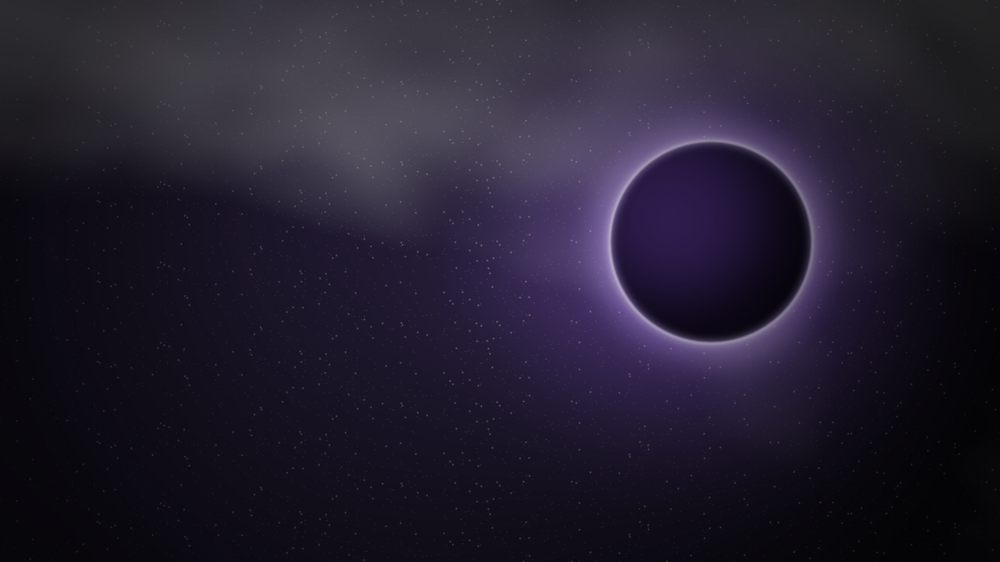

# Void Hunter — thème Omarchy

Un thème sombre et reposant pour [Omarchy](https://omarchy.org), inspiré des chasseurs Void de *Destiny* : mauve doux, ciel nocturne et couleurs feutrées.



## Installation

```bash
omarchy theme install https://github.com/david-dmz/omarchy-void-hunter-theme
omarchy theme set void-hunter
```

## Palette

| Rôle | Couleur |
|---|---|
| Accent (mauve Void) | `#a48fd1` |
| Fond | `#16141f` |
| Texte | `#d6d0e0` |
| Solaire / Arc / Strand / Exotique | `#d29a6e` / `#7fb3c4` / `#8fb59a` / `#d8c08a` |

Les bordures des fenêtres actives ont un dégradé mauve → violet profond. Icônes : Yaru-purple.

## Bonus : CPU et RAM dans la barre

Le script `extras/bar/sysstats` affiche l'utilisation du CPU et de la RAM dans la barre Omarchy (clic → btop).

```bash
mkdir -p ~/.config/omarchy/bar/scripts
cp extras/bar/sysstats ~/.config/omarchy/bar/scripts/
chmod +x ~/.config/omarchy/bar/scripts/sysstats
```

Puis ajoute ce module dans `bar.layout.right` de `~/.config/omarchy/shell.json` :

```json
{ "id": "sysstats", "type": "command", "exec": "~/.config/omarchy/bar/scripts/sysstats", "interval": 2, "tooltip": "CPU / RAM", "onClick": "omarchy-launch-or-focus-tui btop" }
```

## Fonds d'écran Destiny

Le fond d'écran inclus (*Void Eclipse*) est une création originale. Les images officielles de *Destiny* ne sont pas incluses, car elles appartiennent à Bungie. Tu peux les télécharger toi-même depuis le [Bungie Press Room](https://press.bungie.com/Destiny-2) et les placer dans :

```
~/.config/omarchy/backgrounds/void-hunter/
```

Elles apparaîtront ensuite dans le sélecteur (`omarchy background`).

---

Projet de fan non officiel, sans lien avec Bungie. *Destiny* est une marque de Bungie, Inc.
